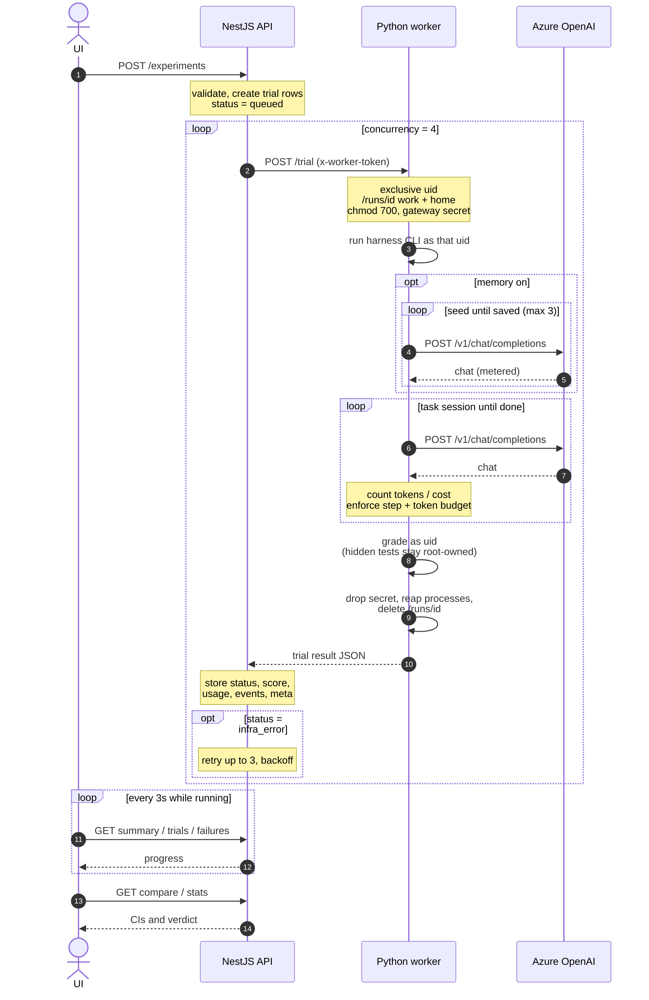
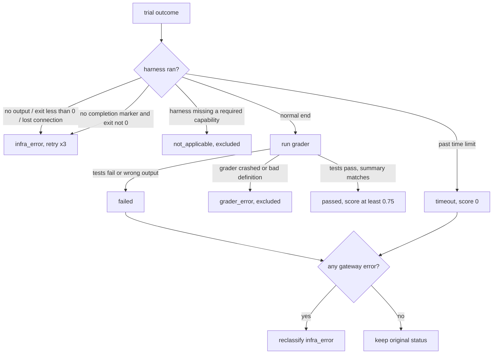

# Agent Evals Platform — project summary

Agents differ by harness, model, and settings. This stack runs the same tasks against those combinations, scores them, and says whether a change actually moved the needle or just sat inside noise.

**Stack.** NestJS API (SQLite), Vue 3 UI, Python / FastAPI worker. `docker compose up --build`.

---

## How the pieces talk

```
  Vue UI                    NestJS API                     Python worker                   Azure OpenAI
 ┌────────┐    REST      ┌──────────────┐     HTTP      ┌─────────────────┐    HTTPS    ┌─────────────┐
 │        │ ───────────► │              │ ────────────► │                 │ ──────────► │             │
 │  SPA   │              │  SQLite      │               │  /trial         │             │  chat       │
 │        │ ◄─────────── │  queue       │ ◄──────────── │  /v1/chat/...   │ ◄────────── │             │
 └────────┘  poll 3s     │  stats       │               │  graders        │             └─────────────┘
                         └──────────────┘               └─────────────────┘
```

The API keeps all state. The worker does not; each `/trial` request includes everything it needs.

| Piece    | Owns                                              | Does not own                    |
|----------|---------------------------------------------------|---------------------------------|
| UI       | screens, polling, URL state                       | stats, queue                    |
| API      | configs, experiments, trials, retries, export     | model calls, sandbox, grading   |
| Worker   | harnesses, gateway, graders, sandbox, usage       | persistence                     |
| Azure    | inference                                         | everything else                 |

---

## One trial (swimlane)



If the worker dies, Azure 429s, or the grader crashes, the trial is retried. That does not count as the agent failing. `/trial` sends a space every 15s so Node does not drop the connection during a long run.

---

## Isolation

Worker process is root. The agent is a throwaway uid. They share the worker container and its network.

```
                         worker container
┌─────────────────────────────────────────────────────────────────────┐
│                                                                     │
│   worker (uid 0)                         agent (uid 2xxxx)          │
│  ┌──────────────────────────────┐       ┌────────────────────────┐  │
│  │ /srv/tasks           700     │  ✗    │                        │  │
│  │ hidden tests, solutions      │────── │                        │  │
│  │ Azure key in env             │  ✗    │                        │  │
│  │ /ipc/worker-token    600     │────── │                        │  │
│  │ other trial dirs             │  ✗    │                        │  │
│  │                              │────── │                        │  │
│  │                              │  ✓    │ /runs/<id>      700    │  │
│  │                              │─────► │ own workdir + home     │  │
│  │                              │  ✓    │ /opt/cache (shared)    │  │
│  │                              │─────► │ harness binaries       │  │
│  │ /v1/chat/completions         │  ✓    │ per-trial bearer       │  │
│  │ needs that trial's secret    │◄───── │ issued at start        │  │
│  │ POST /trial                  │  ✗    │                        │  │
│  │ needs worker-token (API)     │────── │                        │  │
│  └──────────────────────────────┘       └────────────────────────┘  │
│                                                                     │
└─────────────────────────────────────────────────────────────────────┘
```

Unprivileged uid: 401 on `/trial` and on `/v1/chat/completions` with a bad or missing token; `Permission denied` on `/srv/tasks` and `/ipc/worker-token`. A pass over 1,124 tool calls in real runs did not touch hidden tests, solutions, keys, or other trials.

---

## Status

Stats use `passed`, `failed`, and `timeout`. Everything else is dropped.



A pass is never rewritten. Hitting the step/token budget is treated as the agent's result and still graded; the trace gets a `budget_exhausted` event.

---

## Data

SQLite. Three tables. Unique on `(experiment_id, config_id, task_id, trial_idx)` so a cell cannot be inserted twice.

```
 configs                         experiments                      trials
┌──────────────────────┐        ┌──────────────────────┐        ┌──────────────────────────┐
│ id            PK     │◄──┐    │ id            PK     │◄──┐    │ id            PK         │
│ name                 │   │    │ name                 │   │    │ experiment_id FK ────────┤
│ version       INT    │   └────┤ config_ids    JSON   │   └────┤ config_id     FK ────────┤
│ hash          12 hex │        │ task_ids      JSON   │        │ task_id                  │
│ harness              │        │ trials_per_task INT  │        │ trial_idx                │
│ model                │        │ created_at           │        │ status        enum(7)    │
│ settings      JSON   │        └──────────────────────┘        │ score         REAL?      │
│ created_at           │                                        │ reasoning                │
└──────────────────────┘                                        │ duration_ms              │
                                                                │ cost_usd                 │
 edit settings → new name@vN                                    │ usage         JSON       │
 with a new hash. Old trial                                     │ final_text               │
 rows keep their config_id.                                     │ files         JSON       │
                                                                │ events        JSON       │
                                                                │ meta          JSON       │
                                                                │ attempts                 │
                                                                │ UNIQUE (experiment_id,   │
                                                                │   config_id, task_id,    │
                                                                │   trial_idx)             │
                                                                └──────────────────────────┘
```

`meta` holds harness version, Azure deployment, resolved snapshot id, task hash (fixture + tests + skills), budget, nudge, uid. The trial row is enough to say what produced it.

---

## Choices that matter

| Choice | Why |
|---|---|
| Gateway in front of Azure | Both harnesses speak OpenAI chat. Budgets, auth, param stripping, and cost live in one place. Harness-reported usage is not trusted. |
| Task is the unit of analysis | Trials inside a task are repeats. CIs scale with number of tasks. Paired hierarchical bootstrap. |
| Platform fail ≠ agent fail | OOM, dropped connection, 429: retry or exclude. Not a zero. |
| Agent is untrusted | Per-trial uid, scrubbed env, root-only tasks dir, graders do not follow symlinks, hidden pytest outside the workdir, random gateway bearer. |
| Configs do not mutate | Content hash `name@vN`. Results point at the config that actually ran. |
| Adapters, not forks | New harness: one file + registry. New model: one YAML line. There is a dummy third-harness test for this. |

## Trade-offs

- One container, not one per trial. Isolation is uid-based. Fine for normal model use; someone sharing the kernel and trying to break out is not in scope.
- Judge is the same family as the subject (`gpt-4.1-mini` on `gpt-4.1-mini`). Used on 3 of 20 tasks. Agreement with human labels: 79%, kappa 0.55.
- Hermes wants world-writable `installs/`. A hostile agent could mess with it.
- If a failed/timed-out trial also had a gateway error, it becomes `infra_error`. That can throw away a real fail that happened during throttling. Final runs had 0 gateway errors.

---

## Tasks

The 20 tasks mix code, files, exact answers, a few judge rubrics, and four that actually need skills or memory. That is enough to compare harness settings on one model; it is not a general agent leaderboard.

## In / out

**In.** Hermes + OpenCode; Azure `gpt-4.1-mini`; 20 tasks, four grader types; N repeats; isolation, budgets, retries, heartbeats; paired stats with “within noise” / “not enough data”; traces; JSON/CSV; failure rules; 206 offline tests.

**Out.** Second provider / open-weight model (YAML hook is there); per-trial containers; distributed queue; multi-user auth; prompt-cache discount; splitting judge cost onto trials.

## Extension

- **Model** → `config/models.yaml` + `.env`.
- **Harness** → subclass `Harness`, implement `run(ctx)`, register. ~50 lines.
- **Grader** → function + registry in `worker/graders.py`.
- **Failure category** → rule in `api/src/failures.ts`.
- **Stat** → `api/src/stats.ts`.
- **Storage** → `api/src/db.ts` is the only `node:sqlite` user.

---

## Results

Main run: 20 tasks × 3 configs × N = 5 → 290 scored trials, 0 infra errors, $4.36. Raw files in [`docs/results/`](results/); write-up in [`docs/experiment.md`](experiment.md); screenshots in [`docs/screenshots/`](screenshots/).

| config            | mean score (95% CI)   | notes |
|-------------------|-----------------------|-------|
| hermes-plain      | 0.765 [0.585, 0.922]  | baseline |
| hermes-full       | 0.770 [0.588, 0.930]  | skills + memory; Δ vs plain **+0.005 [−0.092, +0.108]** — within noise |
| opencode-skills   | 0.822 [0.667, 0.956]  | Δ vs hermes-full **+0.011 [−0.178, +0.211]** — within noise |

Repeated across two runs:

- Task 19 (memory): plain 0.00 → full 0.80, CI [+0.40, +1.00]. Trace has `USER.md: port 8081`; agent writes `listen 8081;`.
- Task 18 (skill): OpenCode opens the skill 5/5, passes 4/5. Hermes opens it 0/5, passes 0. Same model, same files.
- Aggregate hides opposing tasks. Hermes wins CSV (06); OpenCode wins log-counting (11).

Nudge control (`hermes-full` + “check skills and memory first”): `capability_unused` 10 → 3, cost +$0.012/trial, scores barely move.

---

## Limits (full list: [`docs/limits.md`](limits.md))

- 20 tasks; 11 sit at 1.00. Aggregate CI only really sees effects ≥ ~0.10.
- One model, one provider.
- Judge tasks (3/20) are noisier than unit tests.
- Task 19 prompt was reworded after an early fail — called out in the experiment notes.
- Sandbox is not for adversarial agents.

---

## Run it

```bash
cp .env.example .env
docker compose up --build    # UI + API on :3000
```

- Tests: `cd api && npm test` (55); `cd worker && pytest tests -q` (151); `python tasks/validate.py` (20/20).
- Order to read: [`README.md`](../README.md) → this file → [`docs/design.md`](design.md) → [`docs/experiment.md`](experiment.md) → [`docs/limits.md`](limits.md) → [`docs/cost.md`](cost.md).
